# GitHub Profile Trophy (Go 実装)

[](https://github.com/soulteary/github-profile-trophy)


## Languages / 语言 / Sprachen / Lingue / 언어 / 言語

- [English](README.md)
- [简体中文](README.zh.md)
- [Deutsch](README.de.md)
- [Italiano](README.it.md)
- [한국어](README.kr.md)
- [日本語](README.ja.md)

## 🚀 ゼロ設定、ドロップイン置換

**デプロイ不要！** これは [GitHub Profile Trophy](https://github.com/ryo-ma/github-profile-trophy) プロジェクトの **100% 互換 Go 実装**です。元のサービスの**直接置換**として使用できます - URL を交換するだけで、既存のすべてのパラメータがまったく同じように機能します。

### ✨ この実装を選ぶ理由

| 機能 | 元のプロジェクト | このプロジェクト |
|------|----------------|----------------|
| **デプロイ** | Vercel/クラウドホスティングが必要 | ✅ セルフホスティング、完全な制御 |
| **API 互換性** | - | ✅ 100% 互換、同じパラメータ |
| **パフォーマンス** | Node.js ランタイム | ⚡ Go ランタイム、より高速で軽量 |
| **レート制限** | 単一トークン | 🔄 マルチトークンサポート |
| **キャッシュ** | 限定的 | 💾 メモリ + Redis サポート |
| **メンテナンス** | サービスの可用性に依存 | 🛡️ サービスを制御 |
| **コスト** | 有料ホスティングが必要な場合がある | 💰 無料セルフホスティング |

### 🎯 主な利点

- 🎯 **100% API 互換** - 元のプロジェクトとまったく同じ URL パラメータを使用
- 🚀 **デプロイ不要** - セルフホスティングソリューション、データの完全な制御
- ⚡ **高性能** - より優れたパフォーマンスと低リソース使用のために Go で構築
- 🔄 **マルチトークンサポート** - 複数の GitHub トークンでより高い API レート制限を処理
- 💾 **スマートキャッシュ** - 組み込みメモリキャッシュ + オプションの Redis サポートでより高速な応答
- 🎨 **20+ 美しいテーマ** - すべての元のテーマがサポートされ、さらに追加
- 🛡️ **本番環境対応** - リトライメカニズム、エラーハンドリング、堅牢なアーキテクチャ

### クイックスタート - URL を交換するだけ！

すでに元の GitHub Profile Trophy を使用している場合は、ベース URL を交換するだけです：

**以前（元のプロジェクト）：**
```markdown
[](https://github.com/ryo-ma/github-profile-trophy)
```

**以降（このプロジェクト）：**
```markdown
[](https://github.com/ryo-ma/github-profile-trophy)
```

**すべてのパラメータがまったく同じように機能します！** 既存のコードを変更する必要はありません。

もちろん、**推奨**は GitHub Actions のアプローチを使用することです。Action ファイルで元のリクエストパラメータを更新するだけです：

この例を使用する前に、専用 PAT を保存するリポジトリシークレット `PROFILE_STATS_TOKEN` を作成してください。手順は[トークン設定](https://github.com/soulteary/github-profile-trophy-action/blob/main/README.ja.md)を参照してください。未設定のシークレットは空の値となり、Action はワークフローのリポジトリに限定された `GITHUB_TOKEN` を使用します。

```yaml
- name: Generate trophy card
  uses: soulteary/github-profile-trophy-action@v1
  with:
    options: 'username=${{ github.repository_owner }}&theme=onedark'
    path: .github/assets/trophy.svg
    token: ${{ secrets.PROFILE_STATS_TOKEN }}
```

## 機能

- ✅ 複数のランクを持つトロフィーカード生成 (SSS, SS, S, AAA, AA, A, B, C)
- ✅ 15種類以上のトロフィータイプ (Stars, Commits, Followers, Issues, PRs, Repositories, Reviews など)
- ✅ シークレットトロフィー (MultiLanguage, AllSuperRank, AncientAccount など)
- ✅ 20種類以上のテーマサポート
- ✅ カスタマイズ可能なレイアウト (列、行、マージン)
- ✅ タイトルとランクによるフィルタリング
- ✅ キャッシュサポート (メモリ + Redis)
- ✅ リトライメカニズム付きマルチトークン GitHub API サポート

## 📖 使用例

以下のすべての例は、元のプロジェクトと同じ URL パラメータを使用します。ベース URL を交換するだけです！

### 基本的な使用方法

```markdown
[](https://github.com/ryo-ma/github-profile-trophy)
```


### テーマを使用

```markdown
[](https://github.com/ryo-ma/github-profile-trophy)
```


### タイトルでフィルタリング

```markdown
[](https://github.com/ryo-ma/github-profile-trophy)
```


### ランクでフィルタリング

```markdown
[](https://github.com/ryo-ma/github-profile-trophy)
```


### カスタムレイアウト

```markdown
[](https://github.com/ryo-ma/github-profile-trophy)
```


> 💡 **ヒント：** 元のプロジェクトのすべての URL パラメータがここでも同じように機能します。既存の README コードを変更する必要はありません！

### GitHub Actionsでの使用

[github-profile-trophy-action](https://github.com/soulteary/github-profile-trophy-action)を使用して、CI/CDパイプラインでトロフィーカードを生成できます：

プロフィール統計用の専用 PAT をリポジトリのシークレット `PROFILE_STATS_TOKEN` に保存してください。[トークン設定](https://github.com/soulteary/github-profile-trophy-action/blob/main/README.ja.md)を参照してください。チェックアウトとプッシュには引き続き `GITHUB_TOKEN` を使用します。

```yaml
name: Generate Trophy

on:
  schedule:
    - cron: "0 0 * * *" # 毎日深夜に1回実行
  workflow_dispatch:

jobs:
  generate:
    runs-on: ubuntu-latest
    
    permissions:
      contents: write
    
    steps:
      - name: Checkout code
        uses: actions/checkout@v4

      - name: Generate trophy card
        uses: soulteary/github-profile-trophy-action@v1
        with:
          options: 'username=${{ github.repository_owner }}&theme=gruvbox&column=7&margin-w=15&margin-h=15'
          path: .github/assets/trophy.svg
          token: ${{ secrets.PROFILE_STATS_TOKEN }}

      - name: Commit trophy card
        run: |
          git config user.name "github-actions[bot]"
          git config user.email "41898282+github-actions[bot]@users.noreply.github.com"
          git add .github/assets/trophy.svg
          git commit -m "Update trophy card" || exit 0
          git push
```

次に、生成された画像をREADMEに埋め込みます：

```markdown

```

## 🚀 クイックスタート

### オプション 1: Docker (推奨 - 最も簡単)

```bash
# Docker で実行 - インストール不要！
docker run -d \
  -p 8080:8080 \
  -e GITHUB_TOKEN1=your_github_token_here \
  --name github-profile-trophy \
  soulteary/github-profile-trophy:latest
```

完了！サービスは `http://localhost:8080` で実行中で、既存のすべての URL で使用する準備が整いました。

### オプション 2: ソースからビルド

```bash
# リポジトリをクローン
git clone https://github.com/soulteary/github-profile-trophy.git
cd github-profile-trophy

# ビルド
go build -o github-profile-trophy ./cmd/server

# 実行（GitHub トークンを設定）
GITHUB_TOKEN1=your_github_token_here ./github-profile-trophy
```

### オプション 3: Go インストール

```bash
go install github.com/soulteary/github-profile-trophy/cmd/server@latest
```

### 環境変数

`.env` ファイルを作成するか、環境変数を設定してください：

```bash
# GitHub Personal Access Token (必須)
GITHUB_TOKEN1=your_github_token_here
# API レート制限を増やすために複数のトークンを設定できます
GITHUB_TOKEN2=your_second_token_here

# サーバーポート (オプション、デフォルト: 8080)
PORT=8080

# キャッシュ構成 (オプション)
ENABLE_REDIS=false
REDIS_HOST=localhost
REDIS_PORT=6379
REDIS_USERNAME=
REDIS_PASSWORD=

# 本番環境モード (オプション)
NODE_ENV=production
```

> ⚡ **パフォーマンスのヒント：** 複数の `GITHUB_TOKEN1`、`GITHUB_TOKEN2` などを設定して、より高い API レート制限を自動的に処理できます。

## 🎨 利用可能なテーマ

20+ の美しいテーマから選択してください！元のプロジェクトのすべてのテーマがサポートされています。

### 人気のテーマ

<details>
<summary>すべてのテーマを表示するにはクリック</summary>

## 利用可能なテーマ

### default


### flat


### onedark


### gruvbox


### dracula


### monokai


### chalk


### nord


### alduin


### darkhub


### juicyfresh


### oldie


### buddhism


### radical


### onestar


### discord


### algolia


### gitdimmed


### tokyonight


### matrix


### apprentice


### dark_dimmed


### dark_lover


### kimbie_dark


### aura


</details>

## 📋 API パラメータ

**元のプロジェクトと 100% 互換です！** すべてのパラメータがまったく同じように機能します。

| パラメータ | 説明 | デフォルト | 例 |
|-----------|------|-----------|-----|
| `username` | GitHub ユーザー名 (必須) | - | `?username=ryo-ma` |
| `theme` | テーマ名 | `"default"` | `&theme=onedark` |
| `title` | トロフィータイトルでフィルタリング (カンマ区切り、`-` プレフィックスで除外) | すべて | `&title=Stars,Followers` |
| `rank` | ランクでフィルタリング (カンマ区切り、`-` プレフィックスで除外) | すべて | `&rank=S,AAA` |
| `column` | 最大列数 (`-1` で適応的) | `8` | `&column=7` |
| `row` | 最大行数 | `3` | `&row=2` |
| `margin-w` | トロフィー間の水平マージン | `0` | `&margin-w=15` |
| `margin-h` | トロフィー間の垂直マージン | `0` | `&margin-h=15` |
| `no-bg` | 透明な背景 | `false` | `&no-bg=true` |
| `no-frame` | フレームを非表示 | `false` | `&no-frame=true` |

## 🏆 トロフィータイプ

### ベーストロフィー
- Stars
- Commits
- Followers
- Issues
- Pull Requests
- Repositories
- Reviews

### シークレットトロフィー
- MultiLanguage (10言語以上)
- AllSuperRank (すべてのベーストロフィーが S ランク以上)
- LongTimeUser (10年以上)
- AncientUser (2010年以前)
- OGUser (2008年以前)
- Joined2020 (2020年に参加)
- Organizations (3組織以上)
- Experience (アカウント期間)

## ランクシステム

ランクは次のとおりです: `SECRET`, `SSS`, `SS`, `S`, `AAA`, `AA`, `A`, `B`, `C`, `UNKNOWN`

## プロジェクト構造

```
.
├── cmd/
│   └── server/          # サーバーエントリーポイント
│       └── main.go
├── internal/
│   ├── api/             # API ハンドラー
│   ├── cards/           # カードレンダリングロジック
│   ├── common/           # 共通ユーティリティ
│   ├── fetchers/        # データフェッチャー (GitHub API)
│   ├── themes/          # テーマシステム
│   └── trophies/        # トロフィーシステム
├── go.mod
└── README.md
```

## ✅ 開発状況

**本番環境対応！** すべてのコア機能が完了し、テストされています。

- ✅ プロジェクト基本構造
- ✅ HTTP サーバー (Gin フレームワーク)
- ✅ GitHub API 統合 (GraphQL)
- ✅ リトライメカニズムとマルチトークンサポート
- ✅ キャッシュ処理 (メモリ + Redis)
- ✅ テーマシステム (20+ テーマ)
- ✅ すべてのトロフィータイプ (15+ タイプ)
- ✅ ランク計算
- ✅ すべての API エンドポイント
- ✅ 元のプロジェクトと 100% API 互換

## 貢献

貢献を歓迎します！アイデアがある場合や問題を見つけた場合は、以下を行ってください：
1. このプロジェクトをフォークしてください
2. 機能ブランチを作成してください
3. 変更をコミットしてください
4. ブランチにプッシュしてください
5. Pull Request を開いてください

## ライセンス

このプロジェクトは MIT ライセンスの下でライセンスされています。
